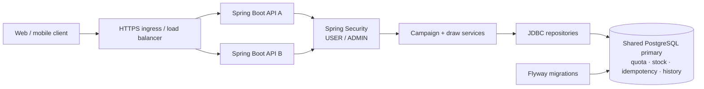

# E-commerce Lottery API

A Java 21 / Spring Boot REST API for configurable prize campaigns. PostgreSQL is the shared source of truth for inventory, per-user limits, draw history, and idempotency, so correctness does not depend on JVM-local locks and holds across multiple API instances.

> **Repository location:** this project is currently in the local folder where you opened it. No GitHub repository has been created or pushed, so there is no GitHub URL yet.

See [Architecture and Transaction Design](docs/architecture.md) for the architecture, request sequence, ER diagram, locking/consistency guarantees, and deployment assumptions. See the [Independent Code Review Guide](docs/review-guide.md) for reproducible checks, review focus areas, and explicit limitations.

## Architecture at a glance



The API tier is stateless; PostgreSQL is the consistency boundary for every instance. The included Compose environment is local development only and does not provide database high availability.

## Run locally

### Docker Compose (recommended)

Install Docker Desktop, optionally copy `.env.example` to `.env` and replace its example passwords, then start PostgreSQL and the API:

```shell
docker compose up --build
```

The demo campaign is seeded automatically. API: `http://localhost:8080`; Swagger UI: `http://localhost:8080/swagger-ui.html`; health: `http://localhost:8080/actuator/health`.

Default **local-only demo** accounts:

- Player: `player` / `local-player-password`
- Administrator: `admin` / `local-admin-password`

Override all default credentials before deployment. For example, put a `.env` file next to `compose.yaml` (it is git-ignored):

```dotenv
DB_PASSWORD=replace-with-a-strong-database-password
LOTTERY_USER_PASSWORD=replace-with-a-strong-player-password
LOTTERY_ADMIN_PASSWORD=replace-with-a-strong-admin-password
```

### Run the API with Maven

Requirements: Java 21, Maven 3.9+, and a PostgreSQL 16 database. Create a database/user matching the defaults (`lottery` / `lottery`) or set `DB_URL`, `DB_USERNAME`, and `DB_PASSWORD`, then run:

```shell
mvn spring-boot:run
```

Flyway applies the schema and seeds a demo campaign at startup. HikariCP settings are configurable with `DB_POOL_MAX_SIZE`, `DB_POOL_MIN_IDLE`, `DB_POOL_CONNECTION_TIMEOUT_MS`, and `DB_POOL_MAX_LIFETIME_MS`; server port uses `SERVER_PORT`.

## Authentication and roles

The local example uses HTTP Basic authentication with two environment-configured in-memory accounts. Any authenticated user can view campaigns and draw; only `ADMIN` can create or update campaigns. The authenticated principal is the user identity used for draw limits—clients cannot submit a different user ID. Basic authentication is suitable only behind HTTPS; replace it with an organization identity provider/OAuth2 resource server for production. Configure distinct passwords for every environment.

## API

JSON errors have the shape:

```json
{
  "timestamp": "2026-01-01T10:00:00Z",
  "status": 400,
  "error": "Bad Request",
  "message": "No-win and prize probabilities must sum to exactly 100.00 percent",
  "path": "/api/v1/campaigns"
}
```

| Method | Route | Permission | Purpose |
|---|---|---|---|
| `GET` | `/api/v1/campaigns` | Authenticated | List campaigns and their current prize stock |
| `GET` | `/api/v1/campaigns/{campaignId}` | Authenticated | Get campaign details |
| `POST` | `/api/v1/campaigns` | Admin | Create a campaign and its prize configuration |
| `PUT` | `/api/v1/campaigns/{campaignId}` | Admin | Replace campaign settings and prize configuration |
| `POST` | `/api/v1/campaigns/{campaignId}/draws` | Authenticated | Draw once or in a batch |

Campaign create/update body:

```json
{
  "name": "Summer Sale",
  "maxDrawsPerUser": 10,
  "enabled": true,
  "noWinProbabilityPercent": 50.00,
  "prizes": [
    { "name": "Headphones", "stock": 5, "probabilityPercent": 5.00 },
    { "name": "Coffee Voucher", "stock": 20, "probabilityPercent": 15.00 },
    { "name": "Bonus Points", "stock": 100, "probabilityPercent": 30.00 }
  ]
}
```

Prize probabilities plus `noWinProbabilityPercent` must sum to exactly `100.00`. Percentages are represented as integer basis points in PostgreSQL (for example, `5.00% = 500`), avoiding floating-point probability errors.

Draw body supports a single draw (`count: 1`) or a batch (`count: 1..100`). Every logical call needs a client-generated `Idempotency-Key` (1–128 characters):

```shell
curl -u player:local-player-password \
  -H "Content-Type: application/json" \
  -H "Idempotency-Key: order-123-draw-1" \
  -d '{"count":3}' \
  http://localhost:8080/api/v1/campaigns/1/draws
```

Retry a timed-out request with the **same key and same count** to receive its original response. Reusing the key with a different count returns `409 Conflict`. Outcomes are `WON`, `NO_PRIZE`, or `SOLD_OUT`; a prize selected after its stock has been exhausted becomes `SOLD_OUT` rather than being rerolled, preserving the configured odds.

### Error behavior

- `400 Bad Request`: invalid fields, malformed JSON, or probability total not equal to 100%.
- `401 Unauthorized` / `403 Forbidden`: missing authentication or insufficient role.
- `404 Not Found`: unknown campaign.
- `409 Conflict`: disabled campaign or idempotency-key payload mismatch.
- `429 Too Many Requests`: request would exceed the user's campaign draw limit.
- `500 Internal Server Error`: unexpected server error; detailed exception is logged server-side and not returned to clients.

## Data model

Flyway DDL/DML is in `src/main/resources/db/migration`. Core relationships:

```text
campaigns 1 ─── * campaign_prizes
campaigns 1 ─── * user_campaign_stats
campaigns 1 ─── * draw_requests 1 ─── * draw_history
```

- `campaign_prizes.stock_remaining` is decremented with a single conditional SQL `UPDATE ... WHERE stock_remaining > 0`; PostgreSQL row locking makes concurrent decrements safe across API instances.
- `user_campaign_stats` has a `(campaign_id, user_id)` primary key and atomically reserves the entire batch under the configured maximum.
- `draw_requests` has a unique `(campaign_id, user_id, idempotency_key)` constraint and stores the original JSON response. A transaction writes the request, reserves quota, decrements stock, writes history, and stores the response together; failures roll the whole operation back.
- Draws share-lock the campaign configuration row; admin replacement obtains an update lock, so a draw sees one consistent configuration. Probability weights are validated before persistence.

### Operations and scaling notes

Run multiple identical stateless API instances behind a load balancer and point them at the same PostgreSQL primary. No in-memory lock or per-instance draw counter is relied on. Size each instance's Hikari pool against the database connection budget; use PostgreSQL HA/failover and backups appropriate to the deployment. The sample Compose setup is for local development, not a production HA topology. For stronger geographic availability, deploy a managed HA PostgreSQL service and terminate TLS at a trusted ingress.

## Tests

```shell
mvn test
```

Unit tests cover probability boundaries and exact probability ranges. PostgreSQL integration tests use Testcontainers to exercise idempotency, quota rollback/retries, and concurrent inventory reservation; they run when Docker is available and are skipped otherwise.

## Repository contents

Includes Maven build configuration, Docker/Compose local environment, Flyway schema and demo seed data, CI workflow, API source, and unit/integration tests. No GitHub repository is created or pushed by this project.
