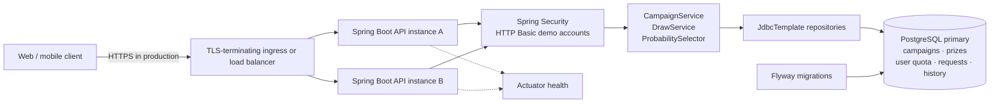
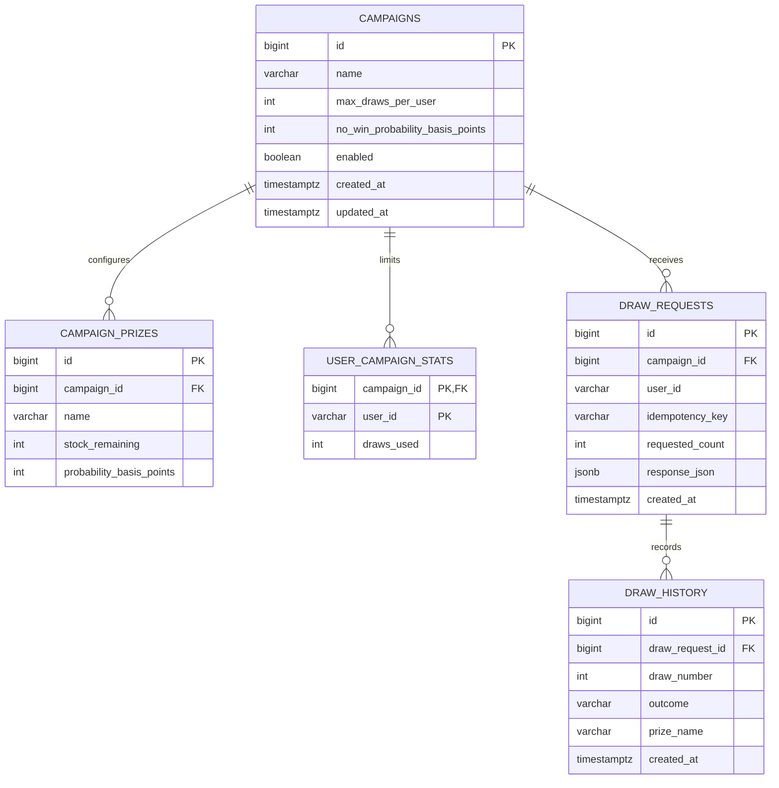

# Architecture and Transaction Design

This document describes the implementation in this repository. It distinguishes guarantees provided by this sample from production infrastructure that must be supplied by a deployment.

## System architecture



The API instances are stateless with respect to draw state. Every instance uses the same PostgreSQL database; the database, not an in-process mutex or cache, is authoritative for prize stock, draw quotas, idempotency, and history. `compose.yaml` starts one API and one local PostgreSQL container; it is a development setup, not an HA deployment.

## Code responsibilities

| Component | Responsibility |
|---|---|
| `api/CampaignController` | Campaign read and admin create/replace endpoints |
| `api/DrawController` | Authenticated single/batch draw endpoint; takes identity from the security principal |
| `api/*Dtos` | Request validation and response contracts |
| `api/ApiExceptionHandler` | Maps validation and domain exceptions into consistent JSON errors |
| `config/SecurityConfig` | Demo HTTP Basic accounts, `USER`/`ADMIN` roles, API authorization |
| `service/CampaignService` | Validates campaign probability totals and coordinates configuration changes |
| `service/DrawService` | Owns one transactional draw request, quota reservation, results, and idempotent response |
| `service/ProbabilitySelector` | Selects outcomes using integer basis-point weights and a `SecureRandom` roll |
| `repository/*Repository` | Parameterized SQL access and PostgreSQL concurrency primitives |
| `db/migration` | Versioned schema and local demo campaign data |

## Draw request lifecycle

Each `POST /api/v1/campaigns/{id}/draws` is one database transaction. A batch of `count` draws is atomic: either the response, quota reservation, inventory decrements, and history all commit, or all roll back.

```mermaid
sequenceDiagram
    autonumber
    actor Client
    participant API as DrawController / DrawService
    participant PG as PostgreSQL
    participant RNG as ProbabilitySelector

    Client->>API: POST {count} + authenticated principal + Idempotency-Key
    API->>PG: BEGIN (Spring @Transactional)
    API->>PG: SELECT campaign FOR SHARE
    API->>PG: INSERT request ON CONFLICT DO NOTHING
    API->>PG: SELECT request FOR UPDATE
    alt Existing key, same count, completed response
        PG-->>API: Stored response JSON
        API-->>Client: Original response; no new quota or inventory changes
    else Existing key, different count
        API-->>Client: 409 Conflict; transaction rolls back
    else New request and enabled campaign
        API->>PG: Atomic quota upsert, conditional on user limit
        loop Each draw in batch
            API->>RNG: Pick a 0..9999 weighted roll
            RNG-->>API: no-prize or configured prize
            opt A prize was selected
                API->>PG: UPDATE stock = stock - 1 WHERE stock > 0
                PG-->>API: 1 row = WON; 0 rows = SOLD_OUT
            end
            API->>PG: INSERT draw_history row
        end
        API->>PG: Persist exact response JSON
        API->>PG: COMMIT
        API-->>Client: Draw results and remaining user allowance
    else Disabled campaign, quota exceeded, or unexpected failure
        API->>PG: ROLLBACK
        API-->>Client: Domain error; no partial draw is committed
    end
```

### Why retries do not draw twice

The database has a unique constraint on `(campaign_id, user_id, idempotency_key)`. A retry uses the same authenticated user, campaign, key, and count:

1. The unique constraint makes concurrent requests with the same key serialize at PostgreSQL.
2. The winner stores its response in the same transaction as the quota, inventory, and history changes.
3. A later request reads and returns the committed response instead of performing another draw.
4. Reusing the key with a different count returns `409 Conflict`.

The server does not accept a client-supplied user ID. HTTP Basic is only the sample authentication mechanism; a production identity provider must supply a stable, globally unique principal name.

## Concurrency and consistency guarantees

### Prize inventory

Prize stock uses one conditional update:

```sql
UPDATE campaign_prizes
SET stock_remaining = stock_remaining - 1
WHERE id = ? AND stock_remaining > 0;
```

PostgreSQL takes a row-level write lock and rechecks the predicate after waiting for a competing writer. Exactly one transaction can decrement the last unit. A zero-row update produces `SOLD_OUT`; it never decrements below zero. The result is not rerolled, so contention does not silently increase another prize's configured odds.

### Per-user limit

`user_campaign_stats` is keyed by `(campaign_id, user_id)`. An `INSERT ... ON CONFLICT DO UPDATE ... WHERE draws_used + requested_count <= max_draws RETURNING draws_used` reserves the entire batch in one statement. The row-level conflict lock serializes concurrent requests for that user and campaign. If the limit would be exceeded, the statement returns no row and the surrounding transaction rolls back.

### Campaign configuration

A draw reads its campaign using `SELECT ... FOR SHARE` and retains that lock through commit. Admin replacement obtains `SELECT ... FOR UPDATE` before replacing the campaign row and its prize rows. This prevents a draw from observing a mixture of old campaign settings and new prizes. Campaign configuration updates and draws are serialized for the same campaign; unrelated campaigns can proceed concurrently.

### Atomicity boundary and isolation

Spring's transaction manager uses one PostgreSQL transaction for each draw request. PostgreSQL's default `READ COMMITTED` isolation is sufficient here because correctness-sensitive changes use unique constraints, row locks, conditional updates, and atomic upserts. Do not move inventory or quota accounting into process-local caches without a design that preserves these database guarantees.

## Data model



The deployable DDL and demo DML are in `src/main/resources/db/migration`. Probabilities are stored as integer basis points (`100.00% = 10000`), not binary floating point. The service validates that the no-prize weight plus every prize weight equals exactly `10000` before writing campaign configuration. Draw history records the prize name at the time of the draw, so replacing a campaign's prize rows does not rewrite past results.

## API and error contract

`GET /v3/api-docs` and `/swagger-ui.html` expose the OpenAPI contract. Campaign reads and draws require an authenticated `USER`; campaign creation and replacement additionally require `ADMIN`. See the README for request examples and status codes.

Domain and validation errors use:

```json
{
  "timestamp": "2026-01-01T10:00:00Z",
  "status": 429,
  "error": "Too Many Requests",
  "message": "The user's draw limit for this campaign would be exceeded",
  "path": "/api/v1/campaigns/1/draws"
}
```

Unexpected exceptions are logged server-side and returned as a generic `500`; internal exception details are not exposed in the response. HTTP Basic authentication must only be used over TLS outside local development.

## Configuration and deployment

`application.yml` reads the JDBC URL, database credentials, port, demo users, and HikariCP settings from environment variables. `.env.example` lists the Compose variables. Do not use sample credentials in a shared or production environment.

For horizontal API scaling, run multiple identical API instances behind a TLS-enabled ingress and connect them to the same PostgreSQL primary. Production availability still requires infrastructure not provisioned here: a highly available PostgreSQL service, backups/restore tests, secrets management, TLS, monitoring/alerts, connection-budget planning, and an operational failover strategy. The included Actuator health endpoint is a basic liveness/readiness signal, not a complete observability system.

## Verification coverage and review boundaries

Run `mvn verify`. Unit tests exercise exact probability boundaries and probability conversion. The Testcontainers integration suite exercises database migration/application behavior, idempotent replay, quota and inventory boundaries, concurrent retries, and concurrent inventory consumption; run it with Docker available.

For an independent review, start with `docs/review-guide.md`. Reviewers should pay particular attention to transaction proxy boundaries, PostgreSQL conflict/locking semantics, principal identity stability, configuration replacement behavior, and whether the production deployment assumptions meet the target environment.
